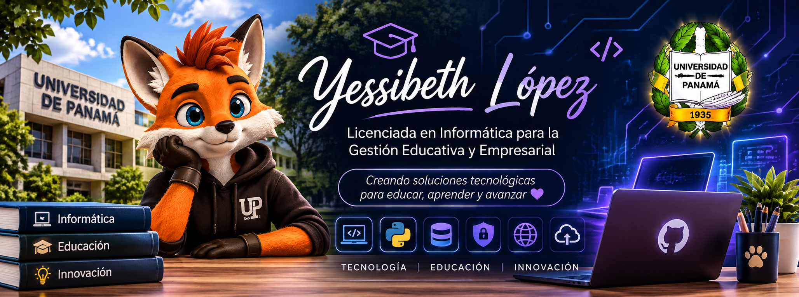

  

<h1 align="center">¡Hola! Soy Yessibeth 👋</h1>

<h3 align="center">
  Estudiante de la Licenciatura en Informática para la Gestión Educativa y Empresarial 
  Universidad de Panamá 🎓
</h3>

---

## 👩‍💻 Sobre mí

¡Hola! Soy Yessibeth López, estudiante de la Licenciatura en Informática para la Gestión Educativa y Empresarial en la Facultad de Informática, Electrónica y Comunicación de la Universidad de Panamá. 🎓

Me apasiona la tecnología y todo lo relacionado con el aprendizaje y la innovación. Siempre estoy dispuesta a participar en cursos, capacitaciones y experiencias que me permitan ampliar mis conocimientos, especialmente en áreas como la informática, el desarrollo de software y la ciberseguridad.

Me gusta explorar nuevas herramientas, descubrir diferentes áreas del mundo tecnológico y convertir lo aprendido en proyectos y soluciones prácticas.

Más allá de la tecnología, disfruto compartir con mis amigos, viajar, conocer nuevos lugares y vivir nuevas experiencias. Creo que mantener un equilibrio entre el crecimiento profesional y la vida personal es fundamental.

✨ Siempre abierta a aprender, colaborar, conocer nuevas personas y participar en proyectos que representen nuevos desafíos y oportunidades de crecimiento.

---

## 🛠️ Tecnologías y herramientas

  
  
  
  
  
  
  

---

## 🔐 Áreas de interés

- 💻 Desarrollo de software
- 🛡️ Ciberseguridad
- 🔌 Electrónica y comunicación
- 🎓 Tecnología aplicada a la educación y a la gestión empresarial

---

<!--
## 🚀 Proyectos destacados

| Proyecto | Descripción | Tecnologías |
|----------|-------------|-------------|
| [🦊 Nombre del proyecto](https://github.com/Yessibeth/nombre-del-repositorio) | Qué hace y para qué sirve | Python, HTML |

---
-->

## 📫 Conecta conmigo

  
  

✨ <i>Siempre abierta a aprender, colaborar y crecer</i> ✨

